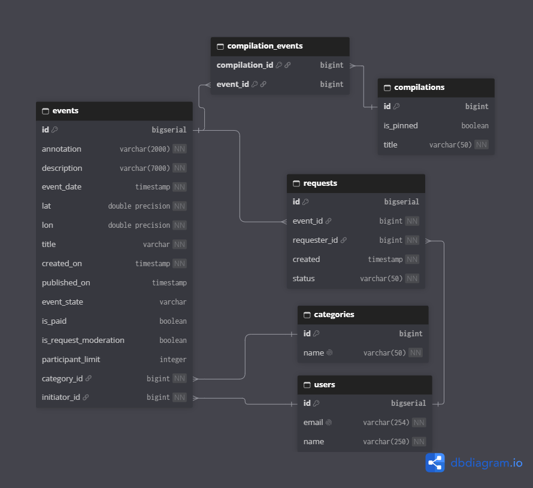

# Explore With Me

Афиша событий. Пользователи предлагают, куда можно сходить или съездить (концерт, сплав на байдарках, прогулка с досками), а другие находят подходящее и подают заявку на участие.

Проект состоит из двух сервисов: основного и сервиса статистики. Адреса и запуск описаны ниже.

## Основной сервис

API разделён на три части по тому, кто им пользуется.

### Публичная часть

Доступна всем без регистрации.

- **События.** Поиск опубликованных событий с фильтрами: текст (ищет в краткой и полной описании без учёта регистра), категории, платные или бесплатные, диапазон дат, только события со свободными местами. Результат можно сортировать по дате события или по числу просмотров, есть постраничная выдача. Если даты не указаны, показываются события, которые ещё не начались. У каждого события видно количество просмотров и количество подтверждённых заявок. Подробная карточка события доступна только для опубликованных событий.
- **Категории.** Список категорий и просмотр одной категории по id.
- **Подборки.** Список подборок (можно отфильтровать закреплённые или незакреплённые) и просмотр подборки по id. Подборку составляет администратор, например «Летние концерты».

### Закрытая часть

Для зарегистрированных пользователей.

- **Свои события.** Создание события, список своих событий, полная информация о своём событии. Событие нельзя назначить раньше, чем через два часа от текущего момента. Изменять можно только события, которые ждут модерации или были отменены, при этом новая дата тоже не может быть ближе двух часов. Через изменение состояния событие отправляется на проверку или снимается с неё.
- **Заявки на участие в чужих событиях.** Пользователь подаёт заявку, смотрит свои заявки и может отменить заявку. Нельзя подать повторную заявку, нельзя участвовать в собственном или ещё не опубликованном событии, а также в событии, где закончились места. Если у события отключена предварительная модерация заявок, заявка подтверждается сразу.
- **Заявки на свои события.** Организатор видит список заявок на своё событие и подтверждает или отклоняет их. Подтвердить можно только заявку в ожидании и только пока не достигнут лимит. Когда лимит исчерпывается, все остальные неподтверждённые заявки автоматически отклоняются. Если лимит равен нулю (то есть не ограничен) или модерация отключена, подтверждать заявки не нужно.

### Административная часть

- **Пользователи.** Добавление, удаление и просмотр списка пользователей (все или по списку id). Электронная почта должна быть уникальной.
- **Категории.** Добавление, изменение и удаление. Название уникально, и удалить можно только категорию, с которой не связано ни одно событие.
- **События.** Поиск по пользователям, состояниям, категориям и датам. Редактирование события и публикация либо отклонение. Опубликовать можно только событие, которое ждёт публикации, и дата начала должна быть не раньше, чем через час. Отклонить можно только неопубликованное событие.
- **Подборки.** Создание (в подборке может не быть событий), обновление и удаление. Подборку можно закрепить на главной странице.

## Как устроено событие

Событие создаётся пользователем и сначала ожидает модерации (PENDING). Администратор либо публикует его (PUBLISHED), либо отклоняет (CANCELED). Автор может отправить событие на проверку или снять его с проверки. У события есть лимит участников (0 означает без ограничений) и флаг, нужна ли подтверждение заявок организатором.

## Сервис статистики

Отдельное приложение. Основной сервис отправляет туда запись о каждом обращении к публичным адресам событий. Сервис возвращает статистику за выбранный период: общее число просмотров и число уникальных (по IP). Из этих данных основной сервис собирает просмотры события и использует их при сортировке.

## Запуск

docker compose up --build

После запуска:
- основной сервис: http://localhost:8080
- сервис статистики: http://localhost:9090
- PostgreSQL снаружи контейнера: localhost:6541 (база `exploreWithMe`)

## Стек технологий

- Java 21
- Spring Boot 3.3 (Spring Web, Spring Data JPA, Validation)
- Hibernate, JPQL
- PostgreSQL (основная БД), H2 (тесты)
- Maven, многомодульный проект
- Lombok, MapStruct
- RestTemplate (клиент для сервиса статистики)
- Docker, Docker Compose
- Checkstyle

## Схема базы данных
